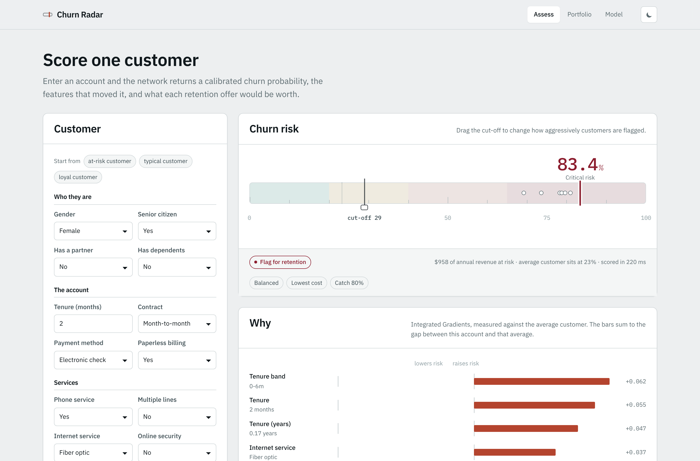
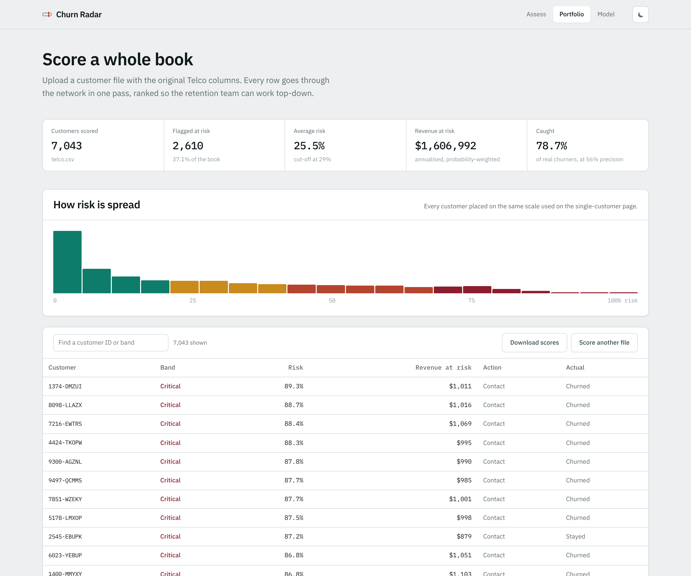
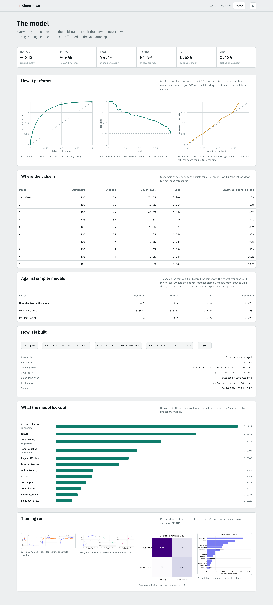
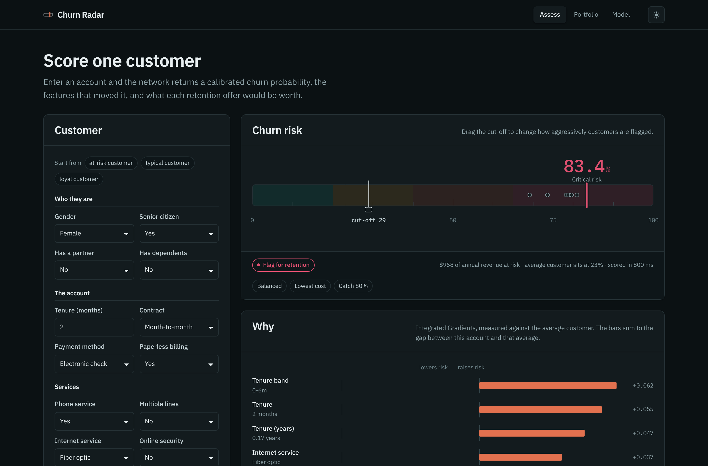

# Churn Radar

Customer churn prediction with an artificial neural network, served as a working
web application: a Keras ANN behind a FastAPI service, with a React dashboard
that explains every prediction and prices the retention offer that would fix it.

Trained on the [Telco Customer Churn](https://www.kaggle.com/datasets/blastchar/telco-customer-churn)
dataset (7,043 customers, 26.5% churn).

<!-- Replace the two URLs below after you push and deploy. -->
[](https://github.com/<aadrikakh-ak>/churn-radar/actions/workflows/ci.yml)
[](https://your-app.onrender.com)




<details>
<summary>More screenshots — portfolio scoring, the model page, dark mode</summary>





</details>

---

## What it does

**Scores one customer.** Fill in an account and the network returns a calibrated
churn probability, the features that pushed it there, and the retention offers
worth making — each one re-scored through the same model, so "move to a 2-year
contract" comes back as an actual number rather than a guess.

**Scores a whole book.** Drop in a CSV with the original Telco columns and all
7,043 rows are scored in one forward pass (~340 ms), ranked so a retention team
can work top-down. If the file still has its `Churn` column, the app reports how
many real churners it caught.

**Shows its working.** A model page carries the held-out test metrics, ROC /
precision-recall / reliability curves, a decile lift table, a comparison against
logistic regression and random forest, and the training plots.

---

## Results

Everything below is on a held-out test split of 1,057 customers that the network
never saw during training, at the decision threshold tuned on a separate
validation split.

| Metric | Score | What it means |
|---|---|---|
| ROC-AUC | **0.843** | ranks a churner above a non-churner 84% of the time |
| PR-AUC | **0.665** | against 0.265 for random guessing |
| Recall | **75.4%** | of real churners are flagged |
| Precision | **54.9%** | of flagged customers really do leave |
| F1 | **0.636** | |
| Brier | **0.137** | probability accuracy after calibration |
| Accuracy | **77.0%** | reported last, because it is the least useful here |

Confusion matrix at threshold 0.29 — 212 true positives, 69 missed churners,
174 false alarms, 602 correctly left alone.

**Accuracy is the wrong headline.** Only 26.5% of these customers churn, so a
model that predicts "nobody leaves" scores 73.5% accuracy and is worth nothing.
This project optimises recall and PR-AUC instead, and reports accuracy for
completeness.

### Does the neural network actually beat the classics?

| Model | ROC-AUC | PR-AUC | F1 |
|---|---|---|---|
| **ANN (this project)** | 0.8431 | 0.6652 | **0.6357** |
| Logistic regression | **0.8447** | **0.6730** | 0.6189 |
| Random forest | 0.8384 | 0.6636 | 0.6377 |

Honestly: **no, not on ranking.** On 7,000 rows of tabular data the network
matches logistic regression and loses to it by 0.002 ROC-AUC — well inside noise.
This is the expected result, and the project reports it rather than hiding it.
Deep learning wins on large, high-dimensional, unstructured data; this dataset is
small, wide and mostly categorical, which is exactly where linear models and
gradient-boosted trees are hard to beat.

What the network does earn is the surrounding machinery: differentiable
end-to-end, so Integrated Gradients gives exact per-customer attributions, and
the what-if engine can re-score hypothetical interventions through the same
function. The F1 edge comes from the ensemble and the tuned threshold.

### Where the value actually is

Customers sorted by risk, cut into ten equal groups:

| Decile | Churn rate | Lift | Churners found so far |
|---|---|---|---|
| 1 (riskiest) | 74.5% | 2.80× | 28% |
| 2 | 57.5% | 2.16× | 50% |
| 3 | 43.8% | 1.65× | 66% |

Calling the riskiest 30% of the book reaches two thirds of everyone who was
going to leave. That table is the business case for the model.

---

## How it works

### The data

7,043 customers, 19 raw columns. Two defects in the Kaggle file are handled in
`ml/data.py`: `TotalCharges` ships as text with 11 blank entries (customers who
joined this month), and the service columns encode "No internet service" as a
third level that means the same thing as "No".

Seven features are engineered on top of the raw columns:

| Feature | Why |
|---|---|
| `AvgChargesPerMonth` | total charges ÷ tenure — what they have really paid per month |
| `ChargesDelta` | current bill minus that average; a recent price rise is a churn signal |
| `MonthlyChargeRatio` | the same idea as a ratio, capped at 5 |
| `NumServices` | how much of the catalogue they use; low adoption means low stickiness |
| `ContractMonths` | contract as a number (1 / 12 / 24) so the network sees the ordering |
| `TenureYears` | a smoother companion scale to raw months |
| `TenureBucket` | tenure banded into 0-6m, 6-12m, 1-2y, 2-4y, 4y+ |

After one-hot encoding this becomes **56 model inputs**. Split 70 / 15 / 15,
stratified on the target.

### The network

```
56 inputs → [Dense 128 → BatchNorm → ReLU → Dropout 0.4]
          → [Dense  64 → BatchNorm → ReLU → Dropout 0.3]
          → [Dense  32 → BatchNorm → ReLU → Dropout 0.2]
          → Dense 1, sigmoid
```

- **BatchNorm before the activation**, so pre-activations stay centred and the
  network survives the fairly heavy dropout that 7k rows demand.
- **Balanced class weights** — the minority class is the one that matters.
- **Early stopping on validation PR-AUC**, not loss or accuracy, with
  `ReduceLROnPlateau` underneath.
- **A 5-network seed ensemble.** Each member trains from a different
  initialisation and lands in a different minimum; averaging cancels some of the
  variance. They are fused into a single Keras graph with an `Average` layer, so
  serving and explanation still deal with one object. Members scored 0.8446 to
  0.8503 validation ROC-AUC individually.

91,685 parameters. Trains in about 3.5 minutes on a CPU.

### Calibrated probabilities

Class weighting makes the network deliberately over-predict churn, so its raw
sigmoid ranks well but lies about magnitude — it would tell you 93% for a
customer who churns about 82% of the time. A dashboard that prints a percentage
has to mean it, so the output is **Platt-scaled** on the validation split:

```
calibrated = sigmoid(a · logit(raw) + b)        a = 1.023,  b = -1.185
```

Brier score **0.173 → 0.134**. Platt was chosen over isotonic regression
deliberately: it is strictly monotonic, so ROC-AUC and PR-AUC are mathematically
unchanged and only the scale moves. Isotonic was tried first and cost 0.03
PR-AUC by tying scores together inside its steps.

### Explanations

Per-customer attributions use **Integrated Gradients**, with the training-set
mean — "the average customer" — as the baseline. Each attribution reads as: how
much of this customer's deviation from average risk is explained by this feature.

KernelSHAP was rejected for serving: it needs thousands of forward passes per
row, far too slow for a synchronous request. Integrated Gradients needs one
batched pass over 64 interpolation steps and satisfies the same completeness
axiom — verified in the test suite, where attributions sum to
f(x) − f(baseline) to three decimals.

One-hot columns are summed back onto their source column, so the UI shows
"Contract type" rather than four disconnected dummy variables.

### Thresholds

A classifier is not finished until somebody picks a cut-off. Three are tuned on
the validation split and exposed in the UI:

| Policy | Threshold | Optimises |
|---|---|---|
| Balanced | 0.29 | F1 |
| Lowest cost | 0.21 | 5 × (missed churner) + 1 × (wasted offer) |
| Catch 80% | 0.295 | best precision at ≥80% recall |

The scale on the assess page is draggable, so the trade-off is something you can
feel rather than a number in a config file.

---

## Running it

### Quick start

```bash
git clone https://github.com/<your-username>/churn-radar.git
cd churn-radar

python -m venv .venv && source .venv/bin/activate   # Windows: .venv\Scripts\activate
pip install -r requirements-dev.txt

uvicorn backend.app.main:app --reload               # API on :8000
```

In a second terminal:

```bash
cd frontend
npm install
npm run dev                                          # UI on :5173
```

Open **http://localhost:5173**. The trained model is committed, so there is
nothing to train before the app works.

### Retraining

```bash
python -m ml.download_data     # optional; a copy is already in data/raw
python -m ml.train             # ~3.5 min on CPU, rewrites artifacts/
```

### Tests

```bash
pytest backend/tests -v        # 16 tests
```

These are behavioural, not just smoke tests: a month-to-month fibre customer one
month in **must** score above a two-year DSL veteran, a two-year contract **must**
lower modelled risk, calibration **must** change the raw number, and a CSV with
missing columns **must** fail with a 422 rather than silently scoring zeros.

### Docker

```bash
docker compose up --build      # everything on :8000
```

The image builds the React app, then serves it from FastAPI, so the whole
project is one container on one port.

---

## Deploying

**Render** (free tier, no card): push to GitHub → New → Blueprint → pick the
repo. `render.yaml` is already here. The free instance sleeps when idle, so the
first request after a sleep takes ~40 s while TensorFlow loads.

**Hugging Face Spaces**: create a Docker Space and push this repo; the
`Dockerfile` works unchanged. Set the Space port to 8000.

**Railway / Fly.io**: both detect the `Dockerfile` with no extra configuration.

**Split deployment** (frontend on Vercel, API elsewhere): set `VITE_API_BASE` to
the API's URL when building the frontend, and `CORS_ORIGINS` to the frontend's
URL on the API.

| Variable | Default | Purpose |
|---|---|---|
| `PORT` | 8000 | injected by most hosts |
| `CORS_ORIGINS` | `*` | comma-separated allowlist |
| `MAX_BATCH_ROWS` | 10000 | CSV upload ceiling |
| `IG_STEPS` | 64 | Integrated Gradients interpolation steps |
| `ARTIFACTS_DIR` | `./artifacts` | where the model files live |

---

## API

Interactive docs at `/api/docs`.

| Endpoint | Does |
|---|---|
| `POST /api/predict` | score one customer, with attributions and actions |
| `POST /api/what-if` | re-score under each retention offer |
| `POST /api/predict/csv` | score an uploaded file |
| `POST /api/predict/batch` | score a JSON array |
| `GET /api/model/metrics` | every number on the model page |
| `GET /api/model/info` | architecture, thresholds, provenance |
| `GET /api/schema` | field definitions that build the form |
| `GET /api/health` | liveness and model status |

```bash
curl -X POST localhost:8000/api/predict \
  -H 'content-type: application/json' \
  -d '{"customer": {"gender":"Female","SeniorCitizen":1,"Partner":"No",
       "Dependents":"No","tenure":2,"PhoneService":"Yes","MultipleLines":"No",
       "InternetService":"Fiber optic","OnlineSecurity":"No","OnlineBackup":"No",
       "DeviceProtection":"No","TechSupport":"No","StreamingTV":"Yes",
       "StreamingMovies":"Yes","Contract":"Month-to-month","PaperlessBilling":"Yes",
       "PaymentMethod":"Electronic check","MonthlyCharges":95.70,"TotalCharges":191.40}}'
```

Invalid categories are rejected by Pydantic with a 422 rather than one-hot
encoding to all zeros and returning a confident, meaningless answer.

---

## Layout

```
churn-radar/
├── ml/                     training pipeline
│   ├── data.py             cleaning + feature engineering (imported by the API)
│   ├── model.py            the Keras ANN and the ensemble fuser
│   ├── calibration.py      Platt scaling, stored as two floats
│   ├── explain.py          Integrated Gradients + permutation importance
│   └── train.py            end-to-end run, writes artifacts/
├── backend/
│   ├── app/                FastAPI service
│   └── tests/              16 behavioural tests
├── frontend/src/
│   ├── components/         RiskScale, DriverChart, CurveChart, CustomerForm
│   └── pages/              Assess, Portfolio, ModelCard
├── artifacts/              trained model, preprocessor, metrics, plots
└── Dockerfile              frontend build + API in one image
```

The backend imports `ml.data.engineer_features` rather than reimplementing it.
Train/serve skew — where a model that scored 0.84 offline quietly returns
nonsense in production because the two pipelines drifted — is the failure this
design exists to prevent.

---

## Honest limitations

- **The dataset is a snapshot, not a time series.** There is no churn date, so
  this predicts *who looks like a churner*, not *who will churn next month*. A
  production system would need time-based splitting to avoid leakage.
- **Correlation, not causation.** "Move to a 2-year contract reduces risk by 14
  points" means customers on 2-year contracts look lower-risk to the model. It
  does not prove the contract causes retention — the customers who sign long
  contracts were probably already more loyal. Proving the offer works needs a
  holdout experiment.
- **Costs are illustrative.** The 5:1 false-negative to false-positive ratio and
  the revenue-at-risk figure (monthly charges × 12 × probability) are plausible
  placeholders, not measured business numbers.
- **The calibration split is small** (1,056 rows), so the Platt coefficients
  carry some variance of their own.
- **7,043 rows is small for deep learning**, which is the honest reason the ANN
  only matches the classical baselines.

---

## License

MIT — see [LICENSE](LICENSE). The dataset is IBM sample data, distributed
publicly via Kaggle.
